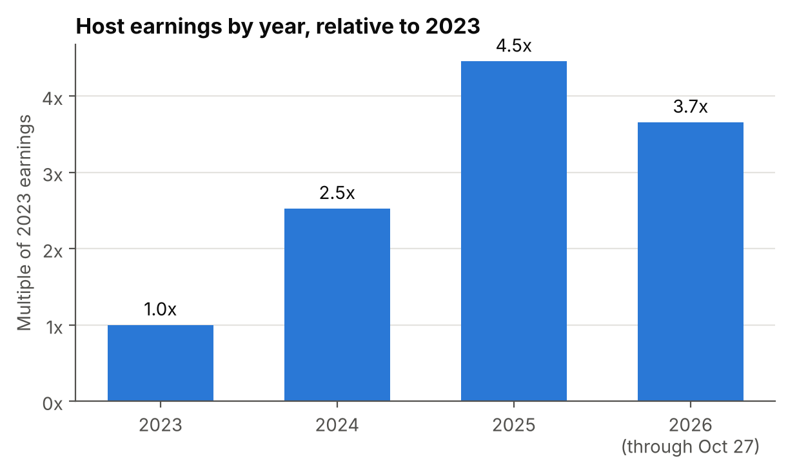
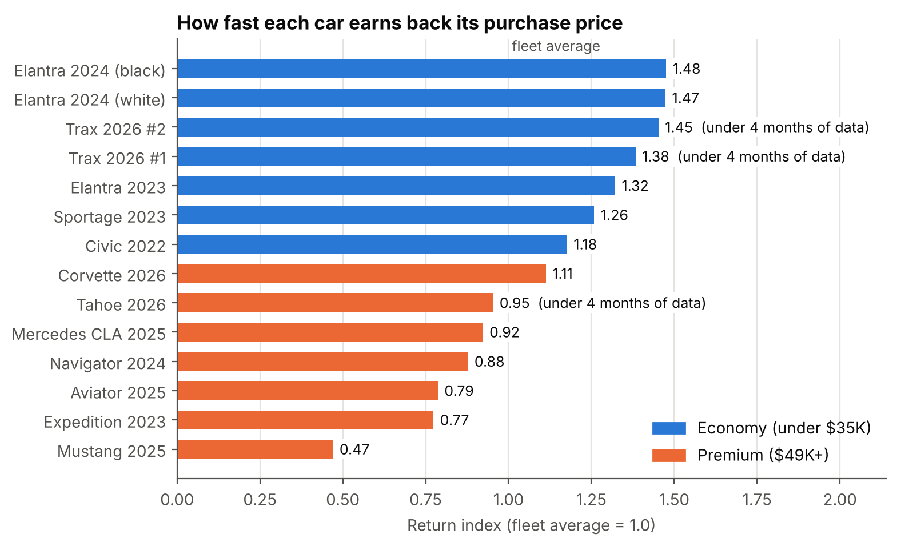
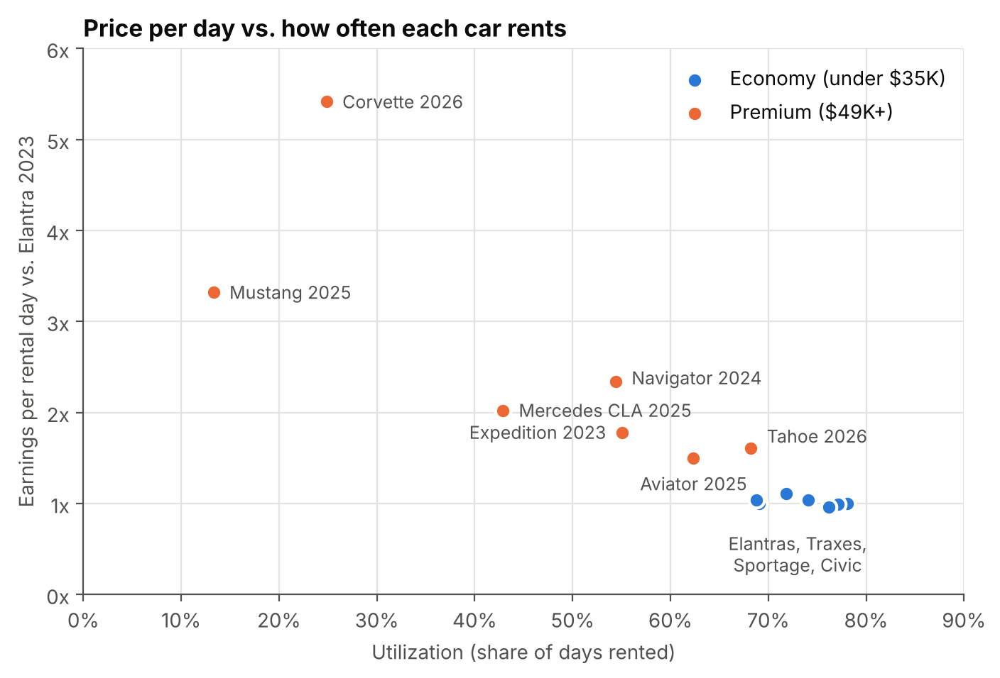

# Rental Fleet Analytics

I started a car rental business on Turo in April 2023 with one financed Hyundai Elantra. It now runs 11 cars, mostly out of Detroit Metro Airport, and has completed about 1,470 trips with a 4.91-star rating.

Every car I buy is a bet that what it earns will justify what I paid. This repo uses my own trip data to check those bets and to make better ones going forward.

> **Privacy:** this is my real business, so the trip data isn't published and all results are shown in **relative terms** (growth multiples, indexes, and utilization) instead of dollars. The code runs on the real numbers.

| Project | Question | Status |
|---|---|---|
| [01 Fleet profitability](notebooks/01_fleet_profitability.ipynb) | Which cars actually paid off, and how fast? | Done |
| 02 Pricing & demand | What should each car cost per day, by season, day of week, and local events? | Planned |
| 03 Winter risk | How much do Michigan winters cost in damage and downtime, and how do I plan for it? | Planned |

## Project 1: Fleet profitability

**Data:** 1,931 bookings (1,469 completed trips) on 14 cars, April 2023 to October 2026, combined from four yearly Turo exports, plus my purchase prices and expense tracker.

### Earnings grew 4.5x from my first year to my third



### Cheap cars earn back their price fastest

For each car, I divided net earnings per month (after operating costs) by its purchase price, then compared it to the fleet average. A score of 1.5 means the car pays for itself 50% faster than average.



- As a group, **economy cars pay for themselves about 1.6x faster than premium cars**.
- Every economy car beats the fleet average. The Corvette is the only premium car that does.
- The **Mustang is the weakest purchase**. It's rented only 13% of the time and earns back its price at about half the average rate, which makes it the first car I'd sell or reprice.

### Premium cars earn more per day but rent far less often



The Corvette earns over 5x more per rental day than an Elantra but is rented only about 25% of the time. Economy cars stay busy 70-80% of the time, and that consistency is what drives their returns.

### Did I make the right call buying an Elantra instead of another Civic?

My personal car was a 2022 Civic, and I listed it on Turo too, so for about 14 months both cars were rented side by side:

| Elantra 2023 vs. Civic 2022 | |
|---|---|
| Purchase price | 14% lower |
| Utilization | 72% vs. 68% |
| Earnings over the same 14 months | 2% higher |
| Return per dollar invested | 19% higher |

The two cars earned almost the same, but the Elantra cost less, so it returned more on every dollar. The data backs up the decision.

### Limitations
- I don't track expenses per car, so operating costs are spread evenly across rental days. Premium cars likely cost more to run, so their real returns are probably lower than shown.
- Depreciation and insurance outside Turo's protection plan aren't included. Both would likely widen the gap in favor of economy cars.
- The Traxes and Tahoe have under 3 months of data, mostly during the busy summer season.
- This is 14 cars in one market. That's enough to guide my own buying decisions, but not enough for strong statistical claims.

## Methods
- **Cleaning ([src/clean.py](src/clean.py)):** merges yearly Turo exports, removes duplicate bookings where the exports overlap, converts Turo's currency text to numbers, and strips guest names, VINs, plates, and addresses.
- **Costs:** annual operating costs (maintenance, parking, washes, gas, registrations, and delivery rides) are divided by rental days in the last 12 months to get a cost per rental day, then charged to each car by how many days it rented.
- **Return:** (earnings - allocated costs) / months listed / purchase price. My financing is 0% APR, so there's no interest to subtract.
- **Indexes:** each car's return is divided by the fleet's pooled return; day rates are divided by the 2023 Elantra's.

## Repo layout

```
src/clean.py       Combines exports, removes duplicates, strips personal info
notebooks/         One notebook per project (outputs normalized, no dollar figures)
figures/           Charts used in this README
data/              Not published (private business data)
```

**Tools:** Python, pandas, NumPy, Matplotlib, Jupyter
